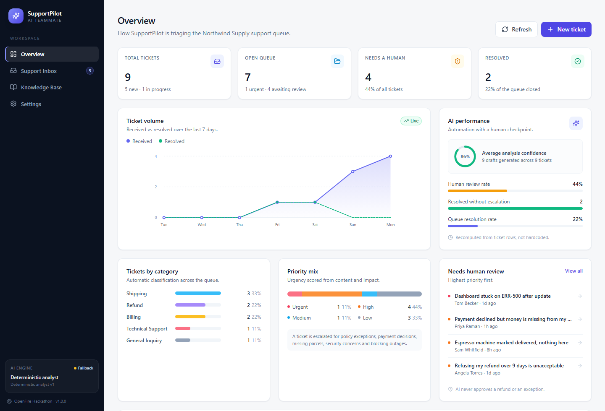
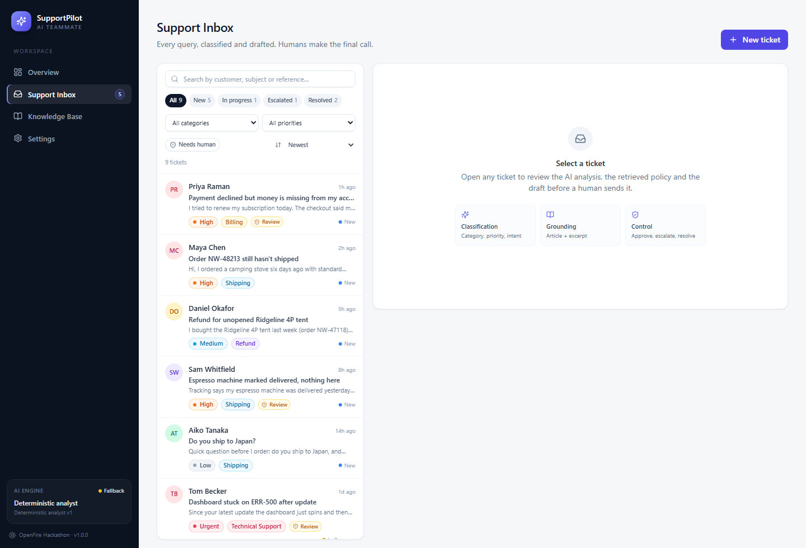
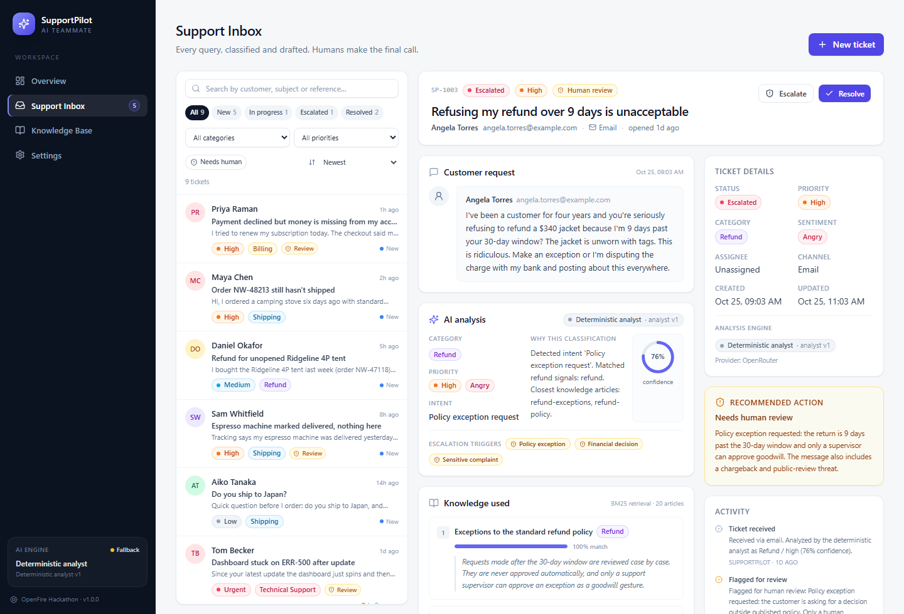
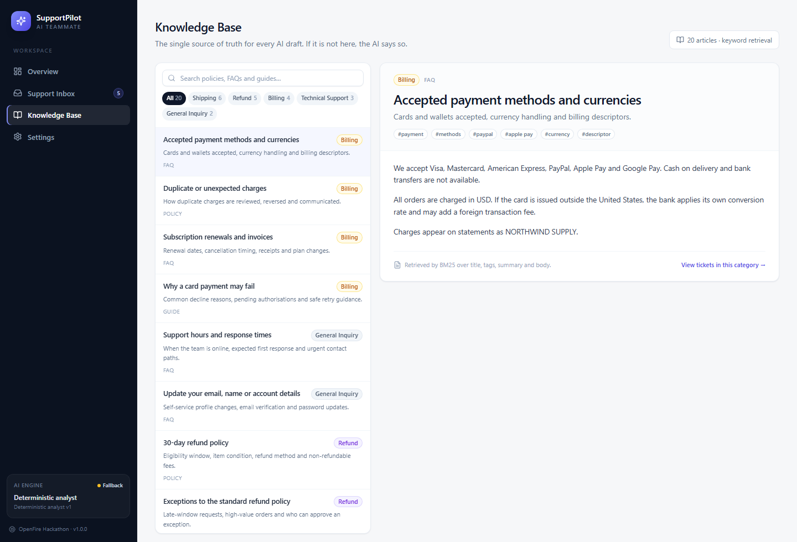
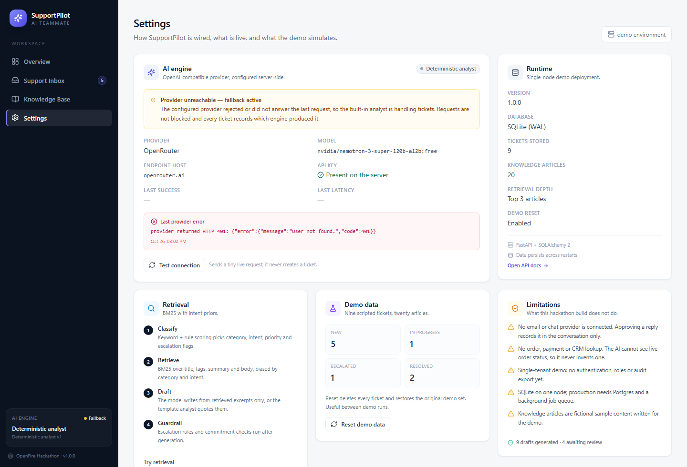

# SupportPilot AI

An autonomous customer support teammate that triages every incoming query, grounds its answer in a company
knowledge base, drafts a reply, and decides whether the ticket can be handled routinely or needs a human.

Built for the **OpenFire Hackathon**. It is a working application, not a mockup: real FastAPI backend, real
SQLite persistence, real retrieval, real ticket workflow.



| Support inbox | Ticket detail |
|---|---|
|  |  |

| Knowledge base | Settings |
|---|---|
|  |  |

---

## What it actually does

A customer message arrives. SupportPilot runs one pipeline and stores every step:

1. **Classify** — category (Billing, Refund, Shipping, Technical Support, General Inquiry), intent, sentiment.
2. **Prioritise** — Low / Medium / High / Urgent from content, impact and urgency signals.
3. **Retrieve** — BM25 search over the knowledge base, biased by category and intent.
4. **Draft** — a reply grounded only in the retrieved excerpts.
5. **Escalate or clear** — explicit rules decide whether a human must review it.
6. **Wait for a human** — the draft is never sent automatically. An agent edits, approves, escalates or resolves.

Every ticket records which engine produced the analysis, which articles were used, and why it was escalated.

---

## Quick start

Requires **Python 3.11+** and **Node 18+**.

```bash
# 1. Backend
python -m venv .venv
.venv\Scripts\activate            # Windows
# source .venv/bin/activate       # macOS / Linux
pip install -r backend/requirements.txt

cp .env.example .env              # then edit if you want a live model

# Start it (kills any stale process on the port and waits for /api/health)
powershell -ExecutionPolicy Bypass -File scripts/start-backend.ps1
# or: cd backend && uvicorn app.main:app --reload --port 8000
```

```bash
# 2. Frontend (second terminal)
cd frontend
npm install
npm run dev                       # http://localhost:5173
```

The API seeds itself on first start with 20 knowledge articles and 9 demo tickets.

- Dashboard: <http://localhost:5173>
- API docs: <http://localhost:8000/docs>
- Health: <http://localhost:8000/api/health>

### Single-process mode

Build the frontend and FastAPI serves it, so one URL runs the whole app:

```bash
cd frontend && npm run build
cd ../backend && uvicorn app.main:app --port 8000
# open http://localhost:8000
```

---

## The AI engine (read this)

SupportPilot has **two interchangeable engines that return the same result shape**.

| | Deterministic analyst | LLM engine |
|---|---|---|
| Needs an API key | No | Yes |
| Classification | Weighted keyword + intent rules | Structured JSON output |
| Drafting | Templates quoting retrieved excerpts | Model-written, excerpt-grounded |
| Escalation | Explicit rules | Model judgement **plus** the same rules |
| Always available | Yes | Only if the provider answers |

**The app is fully functional with no API key.** The LLM is an upgrade, not a dependency. When a provider is
missing or fails, the deterministic analyst handles the request and the UI says so on every screen.

### Alan AI integration — verified findings

I inspected the environment before building rather than assuming an SDK existed:

- Alan's MCP surface exposes **agent-harness tooling** (tasks, sessions, machines, workflows, skills). It does
  **not** expose an app-callable inference endpoint, so a deployed web app cannot call Alan for completions.
- Alan **does** expose the models its harnesses use (DeepSeek, Qwen, Nemotron, Kimi, GLM, MiniMax, Claude, GPT),
  and the session's `OPENROUTER_API_KEY` was present.
- That key was **rejected by the provider** (`HTTP 401: User not found`), so no live model could be verified in
  this environment.

Consequences, stated plainly:

- The LLM integration targets any **OpenAI-compatible `/chat/completions`** endpoint (OpenRouter, Ollama, vLLM,
  LM Studio, Groq, Together). That is a real, tested code path — covered by tests against a mocked provider.
- It is **not** verified against a live model here, because no valid credential existed. The UI never claims
  otherwise: `mode`, `degraded` and `last_error` are reported by the server, not hardcoded.
- Open-source models are supported today via Ollama. See the config block below.

### Enabling a live model

```env
LLM_ENABLED=true
LLM_PROVIDER=OpenRouter
LLM_BASE_URL=https://openrouter.ai/api/v1
LLM_API_KEY=your-key
LLM_MODEL=google/gemma-4-31b-it:free
```

Or run a local open-source model with no key:

```bash
ollama pull qwen2.5:7b-instruct
```

```env
LLM_PROVIDER=Ollama (local)
LLM_BASE_URL=http://127.0.0.1:11434/v1
LLM_API_KEY=ollama
LLM_MODEL=qwen2.5:7b-instruct
```

Restart the API. **Settings → Test connection** sends one small live request and reports the result. After a
failure the client backs off for 60 seconds so a dead provider cannot slow the queue.

---

## Safety: the human stays in control

The prompt asks the model not to invent policy, but prompts are not a guarantee. These are enforced in code,
after generation:

- **Escalation union.** A ticket is escalated if *either* the model or the rules say so. A model cannot
  downgrade a required review.
- **Priority floor.** Deterministic urgency can raise the model's priority, never lower it.
- **Commitment block.** Drafts containing unapproved commitments ("your refund has been approved", "will arrive
  by Friday", "we guarantee", unfilled `[placeholders]`) are discarded and replaced with a grounded draft, and
  the ticket is escalated.
- **No-knowledge rule.** If retrieval returns nothing, the reply says the information is unavailable and the
  ticket goes to a human. This holds even when the LLM is enabled.
- **No automatic actions.** There is no code path that issues a refund, changes an order or sends email.

All of this is covered by tests in `backend/tests/test_llm.py`.

---

## Architecture

```
Browser (React + TS + Tailwind)
        │  REST /api/*
        ▼
FastAPI ── routers ── tickets · knowledge · metrics · system
        │
        ├── service.py     ticket use-cases + audit trail
        ├── analysis.py    classification · escalation rules · drafting · guardrails
        ├── knowledge.py   BM25 index + excerpt selection
        ├── llm.py         OpenAI-compatible client (server-side key only)
        ├── metrics.py     dashboard aggregates from live rows
        └── seed.py        knowledge base + demo tickets
        │
        ▼
SQLite (WAL) — tickets, sources, messages, events, articles
```

### Database schema

- `tickets` — message, classification, priority, status, draft, approved reply, AI provenance, timestamps.
- `ticket_sources` — retrieved articles per ticket, with score and the exact excerpt used.
- `ticket_messages` — conversation: customer, approved replies, internal notes.
- `ticket_events` — audit trail: created, flagged, guardrail, approved, escalated, resolved, reopened.
- `knowledge_articles` — policies, FAQs and troubleshooting guides.

### API

| Method | Endpoint | Purpose |
|---|---|---|
| `GET` | `/api/tickets` | Filter by search, category, priority, status, review flag; sort |
| `POST` | `/api/tickets` | Intake → analyse → store |
| `GET` | `/api/tickets/{id}` | Full ticket with sources, messages, events |
| `PATCH` | `/api/tickets/{id}` | Status / category / priority / assignee |
| `POST` | `/api/tickets/{id}/reanalyze` | Re-run the pipeline |
| `POST` | `/api/tickets/{id}/draft` | Save an edited draft |
| `POST` | `/api/tickets/{id}/approve` | Approve the reply (human action) |
| `POST` | `/api/tickets/{id}/resolve` | Resolve |
| `POST` | `/api/tickets/{id}/escalate` | Escalate with a reason |
| `POST` | `/api/tickets/{id}/reopen` | Reopen |
| `POST` | `/api/tickets/{id}/messages` | Reply or internal note |
| `GET` | `/api/knowledge` | Browse / search articles |
| `POST` | `/api/knowledge/search` | Retrieval preview with scores |
| `GET` | `/api/metrics` | Dashboard aggregates |
| `GET` | `/api/system/status` | AI mode, provider state, counts |
| `POST` | `/api/system/ai/test` | Live provider check |
| `POST` | `/api/system/demo/reset` | Restore demo data |

---

## Demo scenarios

Seeded and ready. Full script in [`docs/DEMO.md`](docs/DEMO.md).

| Customer | Scenario | Result |
|---|---|---|
| Maya Chen | Delayed shipment | Shipping · High · routine draft |
| Daniel Okafor | Refund request | Refund · Medium · routine draft |
| Priya Raman | Failed payment | Billing · High · **escalated** (financial decision) |
| Tom Becker | Technical outage | Technical · Urgent · **escalated** (blocking outage) |
| Angela Torres | Policy exception | Refund · High · **escalated** (supervisor only) |
| Sam Whitfield | Missing parcel | Shipping · High · **escalated** (carrier investigation) |
| Lena Hoffmann | Account email change | General · Low · routine, already resolved |
| Marcus Field | Invoice request | Billing · Low · routine, already resolved |
| Aiko Tanaka | International shipping | Shipping · Low · routine draft |

---

## Verification

```bash
# Backend: 37 tests
cd backend
.venv\Scripts\python.exe -m pytest        # or: python -m pytest
```

Covers: every demo scenario's classification and escalation, grounded drafting, the no-knowledge rule,
API filters and validation, the full human workflow, metrics recomputation, persistence across restarts,
demo reset, the LLM path (structured output, priority floor, escalation union, commitment block,
provider 503 → fallback, invalid JSON → fallback), and regression tests for every QA audit finding.

```bash
# Frontend: strict TypeScript + production build
cd frontend
npm run build
```

```bash
# Browser end-to-end: 40 checks against the running app
cd frontend && npm run build
powershell -ExecutionPolicy Bypass -File scripts/start-backend.ps1
cd frontend && npm run test:e2e            # needs Chrome; set CHROME_PATH if not default
```

The browser suite drives real Chrome through the whole journey: submit a query, read the classification,
verify the grounding, edit the draft, approve it, resolve the ticket, confirm the closed ticket rejects
further approval, filter and search the inbox, reload to prove persistence, and confirm the dashboard
counters moved. It also asserts there are no console errors, page errors or failed requests.

---

## What works vs. what is simulated

**Works end to end**

- Intake, classification, priority, sentiment, intent, escalation with reasons
- BM25 retrieval with visible sources and excerpts
- Grounded drafting, human editing, approval, resolution, escalation, reopening
- Internal notes and conversation history
- Live dashboard metrics, filters, search, sorting
- SQLite persistence across restarts
- LLM integration path with deterministic guardrails

**Simulated or sample**

- Knowledge base is fictional content written for Northwind Supply Co.
- Approving a reply records it in the conversation; **no email/chat provider is connected**
- No order, payment or CRM lookup — so the AI cannot see live order status, and is designed not to pretend to
- No authentication or roles: single-tenant demo

**Needed for production**

- Postgres, migrations (Alembic), background queue for analysis
- Auth, roles, per-agent assignment, audit export
- Real order/payment APIs as read-only tools
- Email/helpdesk integration (Zendesk, Intercom, Gmail)
- Embeddings-based retrieval, feedback loop on edited drafts
- PII redaction and a review of provider data-retention terms

---

## Project layout

```text
support-ai agent/
├── backend/
│   ├── app/
│   │   ├── main.py          app factory, SPA serving
│   │   ├── analysis.py      classification, escalation, drafting, guardrails
│   │   ├── knowledge.py     BM25 retrieval + excerpts
│   │   ├── llm.py           provider client, health, backoff
│   │   ├── service.py       ticket use-cases
│   │   ├── metrics.py       dashboard aggregates
│   │   ├── models.py        SQLAlchemy schema
│   │   ├── demo_data.py     knowledge base + demo tickets
│   │   └── routers/         tickets, knowledge, metrics, system
│   └── tests/               37 backend tests
├── frontend/
│   ├── src/
│   │   ├── pages/           Overview, Inbox, Knowledge Base, Settings
│   │   ├── components/      layout, ticket detail, modal, charts, UI
│   │   └── lib/             api client, types, labels, formatting
│   └── scripts/             e2e-qa.mjs, screenshots.mjs
├── docs/
│   ├── DEMO.md              3-minute demo script
│   └── screenshots/         captured from the running app
├── scripts/
│   └── start-backend.ps1     reliable start: frees the port, waits for health
├── .env.example
└── README.md
```

---

## Configuration

| Variable | Default | Purpose |
|---|---|---|
| `DATABASE_URL` | `sqlite:///./data/supportpilot.db` | Database (relative paths resolve in `backend/`) |
| `SEED_ON_STARTUP` | `true` | Seed demo data when empty |
| `DEMO_RESET_ENABLED` | `true` | Allow the reset endpoint |
| `CORS_ORIGINS` | `http://localhost:5173` | Dev frontend origins |
| `RETRIEVAL_TOP_K` | `3` | Articles retrieved per ticket |
| `LLM_ENABLED` | `true` | Master switch for the LLM |
| `LLM_BASE_URL` | `https://openrouter.ai/api/v1` | Any OpenAI-compatible endpoint |
| `LLM_API_KEY` | *(empty)* | Server-side only; never sent to the browser |
| `LLM_MODEL` | `nvidia/nemotron-3-super-120b-a12b:free` | Model id |
| `LLM_TIMEOUT_SECONDS` | `45` | Per-request timeout |

`.env` is git-ignored. Secrets are read only by the backend; the frontend learns just whether the provider is
configured, degraded or unreachable.

---

## License

MIT — open source, as required by the hackathon.
